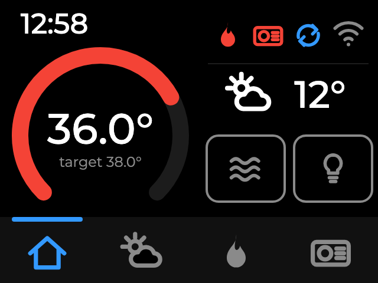
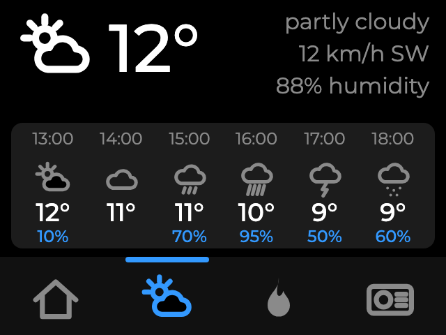
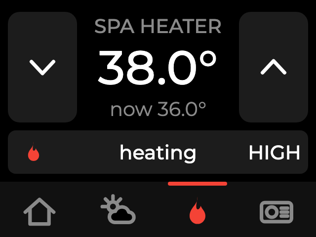
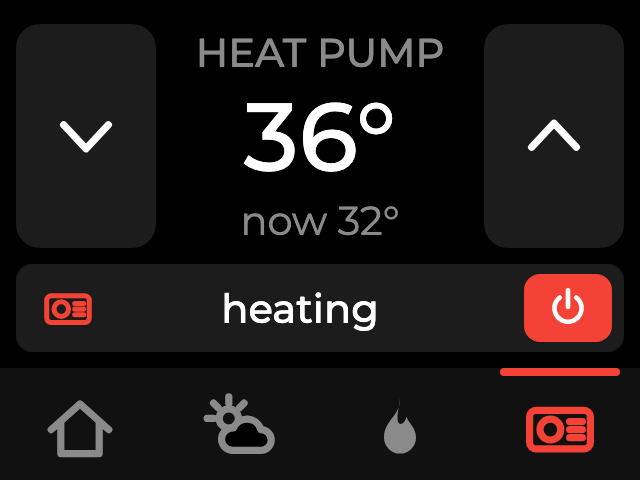

# Balboa spa panel on an M5Stack Tough

An outdoor touch panel for a Balboa-controlled hot tub, built with [ESPHome](https://esphome.io) and Home Assistant. It talks to the spa pack over RS485, shows the water temperature, the weather and the heat pump, and lets you control the heater, jets, lights and heat pump from the terrace without reaching for a phone.

The whole configuration is one file, [jacuzzi.yaml](jacuzzi.yaml).

| Overview | Weather |
|---|---|
|  |  |
| **Spa heater** | **Heat pump** |
|  |  |

Try the layout in your browser: [qonstrukt.github.io/esphome-balboa-spa-panel](https://qonstrukt.github.io/esphome-balboa-spa-panel/), a clickable mock-up of the four pages with sliders for the spa and weather state.

## Hardware

| Part | Role | Notes |
|---|---|---|
| [M5Stack Tough](https://docs.m5stack.com/en/core/tough) | Panel: ESP32, 320x240 touch screen, IP54 case | Board, power, display and touch come from the [esphome-m5tough](https://github.com/Qonstrukt/esphome-m5tough) package |
| [M5Stack RS485 unit (U034)](https://docs.m5stack.com/en/unit/rs485) | RS485 to the spa, and the panel's power supply | On Grove port C (blue, the UART port): TX GPIO14, RX GPIO13 |
| Balboa BP200G1 spa pack | The spa controller | RS485 on connector J34, which also carries 12 V |
| W'eau WSH-005 heat pump | Pool heat pump, controlled through Home Assistant | Any `climate` entity works |
| Home Assistant | Time, weather, forecast, heat pump control | Weather entity: any `weather` integration |

### Wiring

The spa's J34 connector carries A, B, 12 V and ground. A and B go to the RS485 unit; its 12 V input feeds the panel through the Grove port's 5 V pin. Nothing is connected to the Tough's own RS485 screw terminal: that port has a 120 Ω termination resistor that interferes with its one-transistor direction circuit, which made communication unreliable in this setup. The external unit has the same circuit without termination and works.

### Which pins

| Signal | Tough pin | Config |
|---|---|---|
| RS485 TX | GPIO14 | `uart: tx_pin` |
| RS485 RX | GPIO13 | `uart: rx_pin` |
| Touch interrupt, I2C, SPI, backlight | internal | from the m5tough package |

## Components

- [`balboa_spa`](https://github.com/brianfeucht/esphome-balboa-spa) by brianfeucht: the Balboa protocol. Climate, jets, lights, circulation, heater and fault log, plus a "Sync Spa Time" button that this config drives automatically.
- [`m5tough`](https://github.com/Qonstrukt/esphome-m5tough): AXP192 power-up, display, touch and a dimmable backlight light.
- ESPHome's LVGL for the UI, `homeassistant` sensors for weather, forecast and heat pump state, `homeassistant.action` for heat pump control.

One Balboa-specific lesson: do not set `client_id` on `balboa_spa`. The spa assigns channel IDs; a fixed one collides with Balboa's own WiFi module after a power cycle and jams the bus until both give up.

## What the panel does

Four pages behind a 56 px nav bar: overview, weather, spa heater, heat pump.

- **Overview**: clock, water temperature arc with the heater target, status icons for heater, heat pump, circulation and WiFi, the current weather, and two real buttons for jets and lights.
- **Weather**: current condition, temperature, wind and humidity, and the next six hours with rain chance. The hourly forecast comes from a template sensor in Home Assistant, see below.
- **Spa heater** and **heat pump**: big plus and minus buttons for the target, the current state in a strip, and a power button for the heat pump.
- **Screen care**: after two minutes without touch the screen dims to 10 % while the spa is in use (heater target above 30 °C), or shows a lock page and switches the backlight off when the spa is parked. Rain or snow in the weather entity turns the lock into a long press, so drops on the glass do nothing.
- **Spa clock**: every minute the panel compares the time the spa reports with Home Assistant time and resyncs it after a power loss or a daylight saving change.
- **Heat pump follows circulation**: the heat pump is switched on after the circulation pump has run for 90 s and off as soon as it stops, so it never runs without flow. A switch in HA suspends the rule.

Colours, entity ids, the idle timeout, the in-use threshold and the circulation delay are substitutions at the top of the YAML.

## Home Assistant setup

1. **Secrets**: copy [secrets.yaml.example](secrets.yaml.example) to `secrets.yaml` in the ESPHome config folder and fill it in. Besides WiFi and the API key it holds the ids of your weather entity and the forecast sensor, so the YAML itself stays site independent.
2. **Heat pump**: set `heatpump_entity` in the substitutions to your heat pump's `climate` entity.
3. **Hourly forecast**: weather entities no longer carry a forecast attribute, so add the trigger-based template sensor from [ha-forecast-sensor.yaml](ha-forecast-sensor.yaml) to your HA configuration (under `template:`), replace `weather.home` with your weather entity, and reload template entities. Its entity id goes into `forecast_entity` in secrets.yaml.
4. **Actions**: in the HA ESPHome integration, open the device's options and enable "Allow the device to perform Home Assistant actions". The heat pump buttons and the circulation rule need it.

## Tools

[tools/esphome-sync.py](tools/esphome-sync.py) pushes, pulls, validates and installs a config through the ESPHome Device Builder's MCP endpoint (`/api/mcp`), reading the file from disk:

```bash
export ESPHOME_URL=http://homeassistant.local:6052   # or put the URL in ~/.esphome-sync-url
tools/esphome-sync.py push        # upload jacuzzi.yaml and validate it in the builder
tools/esphome-sync.py install     # compile and flash over the air
```

[docs/layout-mockup.html](docs/layout-mockup.html) is the clickable browser mock-up of the LVGL layout, useful for trying layout changes before a compile. `?page=weather&shot=1` opens it on one page in screenshot mode; the images above were made that way with headless Chrome at 640x480.

## Licence

MIT, see [LICENSE](LICENSE).
